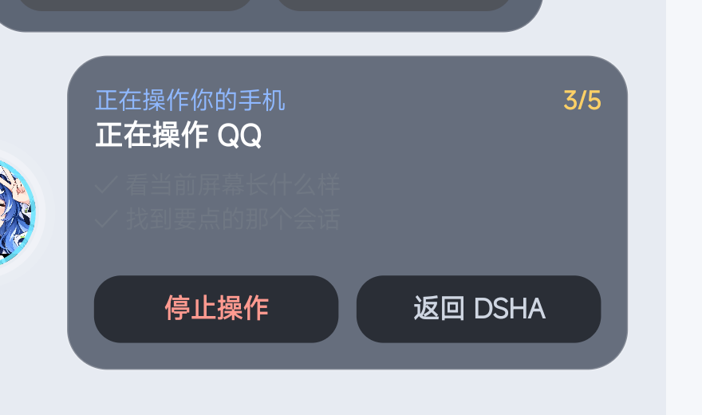
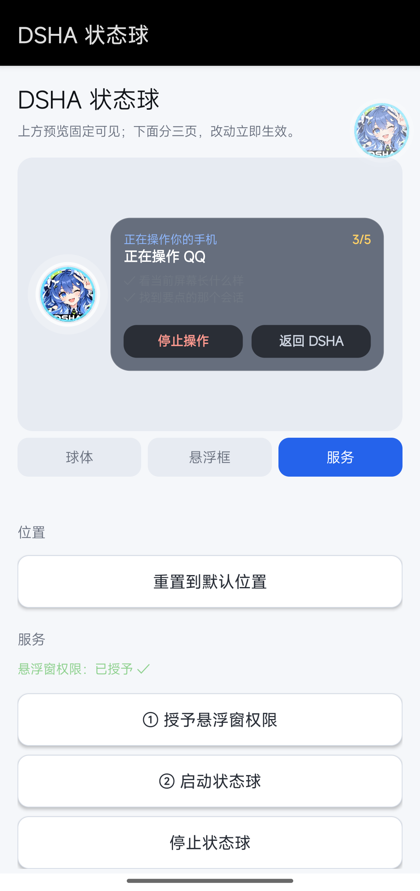

# DSHA 状态球

给 AI agent 用的**手机状态悬浮球**：agent 在操作你的手机时，屏幕上有一个圆形的
头像球；点开它能看到「正在做什么 / 做到第几步 / 最近动作」，并可以随时按下停止。

> 配套 [DSHA](https://github.com/deepseek-ai)（DeepSeek Harness for Android）。
> 球本身是独立 Android App，不依赖 DSHA；插件是可选的数据推送方。



## 它解决什么问题

让 agent 操作手机的过程**可见、可打断**：

- 看不见 → 球上有呼吸光环，正在干活时会亮
- 不知道做到哪 → 卡片里是步骤列表 + `2/5` 进度
- 想喊停 → 卡片里「停止操作」，agent 每次动手前会检查这个标记
- 干完了 → 球自动变亮、卡片自动展开，告诉你「已完成 ✓」

## 功能

**球体**
- 尺寸 36–96dp、呼吸周期 0.6–5s、空闲/点按两档透明度
- 光环开关与颜色（白/青/蓝/金/粉/绿）
- 描边宽度与颜色（避免深色头像糊在深色背景上）
- 自定义头像（相册选图，持久授权）
- 位置记忆，松手自动吸边

**状态卡片**（点球展开）
- 固定宽高（180–420dp × 140–560dp），内容超出时中间区滚动，头和尾不动
- 右上角进度 `2/5`，步骤列表用 ✓ / ▸ / ○ 区分已完成、当前、待做
- 「透明度跟随悬浮球」开关
- 空闲时自动隐藏停止按钮，返回按钮占满整行
- 停止是可逆的：再按一次变「继续操作」

**设置页**
- 三页分类：球体 / 悬浮框 / 服务
- 顶部 250dp 实时预览，切页不影响
- 主题：跟随系统 / 浅色 / 深色



## 安装

1. 下载 `dsha-floatball-x.y.apk`，安装
2. 打开 App，点「① 授予悬浮窗权限」，在系统设置里允许「显示在其他应用上层」
3. 返回，点「② 启动状态球」

球出现在屏幕边缘。拖动可移动，点击展开卡片。

## 与 agent 配合

球监听本机 `127.0.0.1:3091`，任何进程都能推状态：

```bash
# 声明任务与步骤
curl -G "http://127.0.0.1:3091/update" \
  --data-urlencode "state=running" \
  --data-urlencode "task=正在操作 QQ" \
  --data-urlencode "step=正在找到要点的会话" \
  --data-urlencode "steps=看屏幕|找会话|点进去|输入内容|发送" \
  --data-urlencode "cur=2"

# agent 每次动手前检查是否被叫停
curl -s "http://127.0.0.1:3091/state"   # state=running;stop=0;...
```

`tools/ball.sh` 是一个现成的 shell 封装：

```bash
ball plan "看屏幕|找会话|点进去|发送"
ball start "正在操作 QQ"
ball step  "正在找到要点的会话"
ball done  "点开了会话"
ball guard      # 退出码 1 = 用户按了停止
ball idle
```

接口细节见 [docs/PROTOCOL.md](docs/PROTOCOL.md)。

### 可选：DSHA 插件

`plugin/` 里的 `dsh-floatball-bridge` 会监听 agent 会话事件，自动把
「正在执行 / 正在回复 / 空闲」推给球，不需要 agent 主动调用。

```bash
# 放进 DSHA 的插件目录，或按你的 profile 结构 link 进去
```

设计要点：不声明模块级 `inject`（缺服务时会挂掉整棵 plugin tree）、
400ms 节流、所有异常吞掉（球挂了不能影响 agent 干活）、
只推人话文案不推命令行。

## 构建

不需要 Gradle，只用 JDK + Android SDK 的 `aapt2` / `d8`：

```bash
cd app
ANDROID_JAR=/path/to/platforms/android-35/android.jar \
R8_JAR=/path/to/build-tools/xx/r8.jar \
./build.sh
```

产物在 `app/build/floatball.apk`。

arm64 环境跑 x86_64 版 aapt2 时：

```bash
AAPT2_RUN="qemu-x86_64-static -L /usr/x86_64-linux-gnu /usr/x86_64-linux-gnu/lib/ld-linux-x86-64.so.2" ./build.sh
```

首次构建会生成 `app/keystore.jks`（口令 `dshadsha`）。**正式发布请换成自己的
keystore 并保管好**——签名变了就无法覆盖安装。

## 已知限制

- 悬浮窗和卡片**收不到注入的点击**（系统限制，`TYPE_APPLICATION_OVERLAY`
  不参与无障碍点击命中），只能用户自己点
- 球贴到屏幕最顶/最底时，卡片无法再垂直居中（会被状态栏/导航栏挡住），
  此时自动贴边
- 卡片文案由 agent 或插件提供，本项目只负责显示与交互

## License

MIT
